# Project Graph (v2.0)

> [!NOTE]
> Mapa estrutural e semântico para Obsidian e Otimização de Tokens do Antigravity.
> **Atualizado em**: 2026-11-25 15:58:56 | **Stack**: Generic | **Arquivos Indexados**: 142
> **Legenda de Certeza**: `-->` Confirmada | `-.->` Inferida | `⚠️` Dependência Dinâmica/Desconhecida (exige validação no código).

## 1. Índice Estrutural (Visão Rápida)

- **Pontos de Entrada**: [[gradlew.bat]]
- **⚠️ Zona Cega / Conexões Dinâmicas**: Nenhum padrão dinâmico detectado.

## 2. Grafo de Relacionamentos (Mermaid.js)

```mermaid
graph TD
    classDef default fill:#1e1e2e,stroke:#89b4fa,stroke-width:1px,color:#cdd6f4;
    classDef dynamic fill:#312229,stroke:#f9e2af,stroke-width:2px,color:#f9e2af;
    n_README_md["[[README.md]]"] -.->|inferida| n_apk_version_json["[[apk/version.json]]"]
    n_README_md["[[README.md]]"] -.->|inferida| n_config_detekt_detekt_yml["[[config/detekt/detekt.yml]]"]
    n_README_md["[[README.md]]"] -.->|inferida| n_gradlew_bat["[[gradlew.bat]]"]
    n_app_build_gradle_kts["[[app/build.gradle.kts]]"] -.->|inferida| n_apk_version_json["[[apk/version.json]]"]
    n_app_build_gradle_kts["[[app/build.gradle.kts]]"] -.->|inferida| n_config_detekt_detekt_yml["[[config/detekt/detekt.yml]]"]
    n_app_src_main_java_io_github_patodesoxigenado_nexusfetch_data_remote_GitHubUpdateClient_kt["[[app/src/main/java/io/github/patodesoxigenado/nexusfetch/data/remote/GitHubUpdateClient.kt]]"] -.->|inferida| n_apk_version_json["[[apk/version.json]]"]
    n_app_src_main_java_io_github_patodesoxigenado_nexusfetch_domain_model_UpdateInfo_kt["[[app/src/main/java/io/github/patodesoxigenado/nexusfetch/domain/model/UpdateInfo.kt]]"] -.->|inferida| n_apk_version_json["[[apk/version.json]]"]
```

## 3. Detalhamento por Nó (Wikilinks, Símbolos & Resumos)

### [[.github/workflows/android-ci.yml]]
- **Dependências Confirmadas**: Nenhuma
- **Quem usa / Impacto**: Entrypoint ou sem referência estática direta

### [[.gitignore]]
- **Dependências Confirmadas**: Nenhuma
- **Quem usa / Impacto**: Entrypoint ou sem referência estática direta

### [[.gradle/8.11.1/gc.properties]]
- **Dependências Confirmadas**: Nenhuma
- **Quem usa / Impacto**: Entrypoint ou sem referência estática direta

### [[.gradle/buildOutputCleanup/cache.properties]]
- **Dependências Confirmadas**: Nenhuma
- **Quem usa / Impacto**: Entrypoint ou sem referência estática direta

### [[.gradle/file-system.probe]]
- **Dependências Confirmadas**: Nenhuma
- **Quem usa / Impacto**: Entrypoint ou sem referência estática direta

### [[.gradle/vcs-1/gc.properties]]
- **Dependências Confirmadas**: Nenhuma
- **Quem usa / Impacto**: Entrypoint ou sem referência estática direta

### [[LICENSE]]
- **Dependências Confirmadas**: Nenhuma
- **Quem usa / Impacto**: Entrypoint ou sem referência estática direta

### [[README.md]]
- **Dependências Confirmadas**: Nenhuma
- **Dependências Inferidas**: [[apk/version.json]], [[config/detekt/detekt.yml]], [[gradlew.bat]]
- **Quem usa / Impacto**: Entrypoint ou sem referência estática direta

### [[apk/NexusFetch.apk]]
- **Dependências Confirmadas**: Nenhuma
- **Quem usa / Impacto**: Entrypoint ou sem referência estática direta

### [[apk/debug/NexusFetch_arm64-v8a-debug.apk]]
- **Dependências Confirmadas**: Nenhuma
- **Quem usa / Impacto**: Entrypoint ou sem referência estática direta

### [[apk/debug/NexusFetch_armeabi-v7a-debug.apk]]
- **Dependências Confirmadas**: Nenhuma
- **Quem usa / Impacto**: Entrypoint ou sem referência estática direta

### [[apk/version.json]]
- **Dependências Confirmadas**: Nenhuma
- **Quem usa (Inferido)**: [[README.md]], [[app/build.gradle.kts]], [[app/src/main/java/io/github/patodesoxigenado/nexusfetch/data/remote/GitHubUpdateClient.kt]], [[app/src/main/java/io/github/patodesoxigenado/nexusfetch/domain/model/UpdateInfo.kt]]

### [[app/build.gradle.kts]]
- **Dependências Confirmadas**: Nenhuma
- **Dependências Inferidas**: [[apk/version.json]], [[config/detekt/detekt.yml]]
- **Quem usa / Impacto**: Entrypoint ou sem referência estática direta

### [[app/proguard-rules.pro]]
- **Dependências Confirmadas**: Nenhuma
- **Quem usa / Impacto**: Entrypoint ou sem referência estática direta

### [[app/src/main/AndroidManifest.xml]]
- **Dependências Confirmadas**: Nenhuma
- **Quem usa / Impacto**: Entrypoint ou sem referência estática direta

### [[app/src/main/java/io/github/patodesoxigenado/nexusfetch/MainActivity.kt]]
- **Resumo (IA)**:
  - Activity principal Jetpack Compose Material 3 com Edge-to-Edge e solicitação de permissão de notificações (API 33+).
  - Recebe payloads profundos enviados pela [[ShareSheetActivity.kt]] e os roteia para [[NexusNavHost.kt]].
- **Dependências Confirmadas**: Nenhuma
- **Quem usa / Impacto**: Entrypoint ou sem referência estática direta

### [[app/src/main/java/io/github/patodesoxigenado/nexusfetch/NexusFetchApp.kt]]
- **Resumo (IA)**:
  - Entrypoint @HiltAndroidApp do aplicativo Android com captura global de crashes no [[NexusLogger.kt]].
  - Executa limpeza de diretórios temporários órfãos via [[WorkDirCleaner.kt]] e inicialização/auto-update assíncrono do [[YoutubeDlEngine.kt]].
- **Dependências Confirmadas**: Nenhuma
- **Quem usa / Impacto**: Entrypoint ou sem referência estática direta

### [[app/src/main/java/io/github/patodesoxigenado/nexusfetch/ShareSheetActivity.kt]]
- **Resumo (IA)**:
  - Activity transparente dedicada para ACTION_SEND e ACTION_SEND_MULTIPLE (links e arquivos locais).
  - Abre o [[QuickShareBottomSheet.kt]] conectado ao [[QuickShareViewModel.kt]] e encaminha arquivos locais ao [[MainActivity.kt]].
- **Dependências Confirmadas**: Nenhuma
- **Quem usa / Impacto**: Entrypoint ou sem referência estática direta

### [[app/src/main/java/io/github/patodesoxigenado/nexusfetch/data/engine/FfmpegProcessExecutor.kt]]
- **Dependências Confirmadas**: Nenhuma
- **Quem usa / Impacto**: Entrypoint ou sem referência estática direta

### [[app/src/main/java/io/github/patodesoxigenado/nexusfetch/data/engine/Media3Transcoder.kt]]
- **Dependências Confirmadas**: Nenhuma
- **Quem usa / Impacto**: Entrypoint ou sem referência estática direta

### [[app/src/main/java/io/github/patodesoxigenado/nexusfetch/data/engine/MediaCompressorEngine.kt]]
- **Resumo (IA)**:
  - Compressor híbrido Discord/WhatsApp usando [[CompressionPlanCalculator.kt]] sem upsample de FPS e headroom HW (0.82x).
  - Tenta Media3 MediaCodec primeiro e usa fallback rápido FFmpeg libx264 1-Pass VBV (-preset veryfast) com retentativa de segurança.
- **Dependências Confirmadas**: Nenhuma
- **Quem usa / Impacto**: Entrypoint ou sem referência estática direta

### [[app/src/main/java/io/github/patodesoxigenado/nexusfetch/data/engine/MediaConverterEngine.kt]]
- **Resumo (IA)**:
  - Conversor em lote com remux instantâneo (-c copy) para MKV/MOV/MP4 compatíveis na resolução original.
  - Combina [[Media3Transcoder.kt]] (MP4/MKV/MOV) e fallback FFmpeg (-preset veryfast) via [[FfmpegProcessExecutor.kt]].
- **Dependências Confirmadas**: Nenhuma
- **Quem usa / Impacto**: Entrypoint ou sem referência estática direta

### [[app/src/main/java/io/github/patodesoxigenado/nexusfetch/data/engine/MediaProber.kt]]
- **Resumo (IA)**:
  - Sonda zero-copy de mídias locais combinando MediaMetadataRetriever e MediaExtractor para obter duração, resolução, FPS e codecs sem copiar arquivos.
  - Usa ffprobe via [[FfmpegProcessExecutor.kt]] como fallback para containers exóticos.
- **Dependências Confirmadas**: Nenhuma
- **Quem usa / Impacto**: Entrypoint ou sem referência estática direta

### [[app/src/main/java/io/github/patodesoxigenado/nexusfetch/data/engine/MediaTrimmerEngine.kt]]
- **Resumo (IA)**:
  - Recorte rápido remoto via [[YoutubeDlEngine.kt]] (--download-sections sem baixar vídeo completo) e local via [[FfmpegProcessExecutor.kt]] (-c copy com fallback silencioso).
  - Valida intervalos e formatos 2K/4K (VP9/AV1) pelo [[TrimRangeValidator.kt]].
- **Dependências Confirmadas**: Nenhuma
- **Quem usa / Impacto**: Entrypoint ou sem referência estática direta

### [[app/src/main/java/io/github/patodesoxigenado/nexusfetch/data/engine/YoutubeDlEngine.kt]]
- **Resumo (IA)**:
  - Encapsula youtubedl-android (yt-dlp + ffmpeg) com cache LRU de metadados (5 min), auto-update STABLE/NIGHTLY e recuperação 403.
  - Usa fast-paths HTTPS antes do Python para YouTube ([[YouTubeFastMetaClient.kt]]), Twitter ([[TwitterSyndicationClient.kt]]) e Instagram ([[InstagramMetaClient.kt]]).
- **Dependências Confirmadas**: Nenhuma
- **Quem usa / Impacto**: Entrypoint ou sem referência estática direta

### [[app/src/main/java/io/github/patodesoxigenado/nexusfetch/data/local/datastore/SettingsRepository.kt]]
- **Dependências Confirmadas**: Nenhuma
- **Quem usa / Impacto**: Entrypoint ou sem referência estática direta

### [[app/src/main/java/io/github/patodesoxigenado/nexusfetch/data/local/db/HistoryDao.kt]]
- **Dependências Confirmadas**: Nenhuma
- **Quem usa / Impacto**: Entrypoint ou sem referência estática direta

### [[app/src/main/java/io/github/patodesoxigenado/nexusfetch/data/local/db/HistoryEntity.kt]]
- **Dependências Confirmadas**: Nenhuma
- **Quem usa / Impacto**: Entrypoint ou sem referência estática direta

### [[app/src/main/java/io/github/patodesoxigenado/nexusfetch/data/local/db/NexusDatabase.kt]]
- **Resumo (IA)**:
  - Banco SQLite local via Room com histórico de mídias processadas ([[HistoryDao.kt]]) e fila persistente de Multi-Download ([[PendingQueueDao.kt]]).
  - Consome entidades normalizadas [[HistoryEntity.kt]] e [[PendingQueueEntity.kt]].
- **Dependências Confirmadas**: Nenhuma
- **Quem usa / Impacto**: Entrypoint ou sem referência estática direta

### [[app/src/main/java/io/github/patodesoxigenado/nexusfetch/data/local/db/PendingQueueDao.kt]]
- **Dependências Confirmadas**: Nenhuma
- **Quem usa / Impacto**: Entrypoint ou sem referência estática direta

### [[app/src/main/java/io/github/patodesoxigenado/nexusfetch/data/local/db/PendingQueueEntity.kt]]
- **Dependências Confirmadas**: Nenhuma
- **Quem usa / Impacto**: Entrypoint ou sem referência estática direta

### [[app/src/main/java/io/github/patodesoxigenado/nexusfetch/data/local/storage/MediaStorePublisher.kt]]
- **Resumo (IA)**:
  - Publica arquivos finalizados nas coleções públicas Movies/Music/Pictures/Download/NexusFetch com fallback automático para Downloads.
  - Usa fluxo atômico IS_PENDING (1 -> 0) no Android 10+ e MediaScannerConnection na API 26–28.
- **Dependências Confirmadas**: Nenhuma
- **Quem usa / Impacto**: Entrypoint ou sem referência estática direta

### [[app/src/main/java/io/github/patodesoxigenado/nexusfetch/data/local/storage/UriFileResolver.kt]]
- **Dependências Confirmadas**: Nenhuma
- **Quem usa / Impacto**: Entrypoint ou sem referência estática direta

### [[app/src/main/java/io/github/patodesoxigenado/nexusfetch/data/local/storage/WorkDirCleaner.kt]]
- **Dependências Confirmadas**: Nenhuma
- **Quem usa / Impacto**: Entrypoint ou sem referência estática direta

### [[app/src/main/java/io/github/patodesoxigenado/nexusfetch/data/remote/DirectMediaDownloader.kt]]
- **Dependências Confirmadas**: Nenhuma
- **Quem usa / Impacto**: Entrypoint ou sem referência estática direta

### [[app/src/main/java/io/github/patodesoxigenado/nexusfetch/data/remote/GitHubUpdateClient.kt]]
- **Resumo (IA)**:
  - Consulta o manifesto apk/version.json no repositório oficial selecionando APK Release ou Debug compatível com a ABI via [[AppUpdatePolicy.kt]].
  - Valida obrigatoriamente checksum SHA-256 antes de baixar via [[DirectMediaDownloader.kt]] e gerar Intent de instalação via FileProvider.
- **Dependências Confirmadas**: Nenhuma
- **Dependências Inferidas**: [[apk/version.json]]
- **Quem usa / Impacto**: Entrypoint ou sem referência estática direta

### [[app/src/main/java/io/github/patodesoxigenado/nexusfetch/data/remote/InstagramMetaClient.kt]]
- **Resumo (IA)**:
  - Busca posts públicos e carrosséis do Instagram em paralelo (/p/ e /embed/captioned/) com fallback curl UA e telemetria.
  - Delega parsing de OpenGraph, contextJSON (edge_sidecar_to_children) e carrosséis mistos ao [[InstagramMetaParser.kt]].
- **Dependências Confirmadas**: Nenhuma
- **Quem usa / Impacto**: Entrypoint ou sem referência estática direta

### [[app/src/main/java/io/github/patodesoxigenado/nexusfetch/data/remote/TwitterSyndicationClient.kt]]
- **Dependências Confirmadas**: Nenhuma
- **Quem usa / Impacto**: Entrypoint ou sem referência estática direta

### [[app/src/main/java/io/github/patodesoxigenado/nexusfetch/data/remote/YouTubeFastMetaClient.kt]]
- **Resumo (IA)**:
  - Busca HTML gzipado do YouTube Watch em até 6s evitando inicialização de Python/QuickJS no Share Sheet.
  - Delega parsing de ytInitialPlayerResponse e tamanhos ao [[YouTubeFastMetaParser.kt]].
- **Dependências Confirmadas**: Nenhuma
- **Quem usa / Impacto**: Entrypoint ou sem referência estática direta

### [[app/src/main/java/io/github/patodesoxigenado/nexusfetch/data/telemetry/NetworkGuard.kt]]
- **Dependências Confirmadas**: Nenhuma
- **Quem usa / Impacto**: Entrypoint ou sem referência estática direta

### [[app/src/main/java/io/github/patodesoxigenado/nexusfetch/data/telemetry/NexusLogger.kt]]
- **Dependências Confirmadas**: Nenhuma
- **Quem usa / Impacto**: Entrypoint ou sem referência estática direta

### [[app/src/main/java/io/github/patodesoxigenado/nexusfetch/di/CoroutineModule.kt]]
- **Dependências Confirmadas**: Nenhuma
- **Quem usa / Impacto**: Entrypoint ou sem referência estática direta

### [[app/src/main/java/io/github/patodesoxigenado/nexusfetch/di/DatabaseModule.kt]]
- **Dependências Confirmadas**: Nenhuma
- **Quem usa / Impacto**: Entrypoint ou sem referência estática direta

### [[app/src/main/java/io/github/patodesoxigenado/nexusfetch/di/NetworkModule.kt]]
- **Dependências Confirmadas**: Nenhuma
- **Quem usa / Impacto**: Entrypoint ou sem referência estática direta

### [[app/src/main/java/io/github/patodesoxigenado/nexusfetch/domain/error/NexusError.kt]]
- **Dependências Confirmadas**: Nenhuma
- **Quem usa / Impacto**: Entrypoint ou sem referência estática direta

### [[app/src/main/java/io/github/patodesoxigenado/nexusfetch/domain/model/AppSettings.kt]]
- **Dependências Confirmadas**: Nenhuma
- **Quem usa / Impacto**: Entrypoint ou sem referência estática direta

### [[app/src/main/java/io/github/patodesoxigenado/nexusfetch/domain/model/CompressionPlan.kt]]
- **Dependências Confirmadas**: Nenhuma
- **Quem usa / Impacto**: Entrypoint ou sem referência estática direta

### [[app/src/main/java/io/github/patodesoxigenado/nexusfetch/domain/model/CompressionPreset.kt]]
- **Dependências Confirmadas**: Nenhuma
- **Quem usa / Impacto**: Entrypoint ou sem referência estática direta

### [[app/src/main/java/io/github/patodesoxigenado/nexusfetch/domain/model/ConversionSpec.kt]]
- **Dependências Confirmadas**: Nenhuma
- **Quem usa / Impacto**: Entrypoint ou sem referência estática direta

### [[app/src/main/java/io/github/patodesoxigenado/nexusfetch/domain/model/HistoryEntry.kt]]
- **Dependências Confirmadas**: Nenhuma
- **Quem usa / Impacto**: Entrypoint ou sem referência estática direta

### [[app/src/main/java/io/github/patodesoxigenado/nexusfetch/domain/model/MediaFileInfo.kt]]
- **Dependências Confirmadas**: Nenhuma
- **Quem usa / Impacto**: Entrypoint ou sem referência estática direta

### [[app/src/main/java/io/github/patodesoxigenado/nexusfetch/domain/model/MediaJob.kt]]
- **Dependências Confirmadas**: Nenhuma
- **Quem usa / Impacto**: Entrypoint ou sem referência estática direta

### [[app/src/main/java/io/github/patodesoxigenado/nexusfetch/domain/model/MediaMetadata.kt]]
- **Dependências Confirmadas**: Nenhuma
- **Quem usa / Impacto**: Entrypoint ou sem referência estática direta

### [[app/src/main/java/io/github/patodesoxigenado/nexusfetch/domain/model/MultiDownloadItem.kt]]
- **Dependências Confirmadas**: Nenhuma
- **Quem usa / Impacto**: Entrypoint ou sem referência estática direta

### [[app/src/main/java/io/github/patodesoxigenado/nexusfetch/domain/model/Platform.kt]]
- **Dependências Confirmadas**: Nenhuma
- **Quem usa / Impacto**: Entrypoint ou sem referência estática direta

### [[app/src/main/java/io/github/patodesoxigenado/nexusfetch/domain/model/TrimSpec.kt]]
- **Dependências Confirmadas**: Nenhuma
- **Quem usa / Impacto**: Entrypoint ou sem referência estática direta

### [[app/src/main/java/io/github/patodesoxigenado/nexusfetch/domain/model/UpdateInfo.kt]]
- **Dependências Confirmadas**: Nenhuma
- **Dependências Inferidas**: [[apk/version.json]]
- **Quem usa / Impacto**: Entrypoint ou sem referência estática direta

### [[app/src/main/java/io/github/patodesoxigenado/nexusfetch/domain/policy/AggregateProgressCalculator.kt]]
- **Dependências Confirmadas**: Nenhuma
- **Quem usa / Impacto**: Entrypoint ou sem referência estática direta

### [[app/src/main/java/io/github/patodesoxigenado/nexusfetch/domain/policy/AppUpdatePolicy.kt]]
- **Resumo (IA)**:
  - Política Kotlin pura que resolve atualizações Release (apk/NexusFetch.apk) e Debug por ABI (apk/debug/*.apk) a partir de version.json.
  - Controla cooldown periódico (6h), bloqueia path traversal fora de apk/ e valida SHA-256; consumida por [[GitHubUpdateClient.kt]] e [[SettingsViewModel.kt]].
- **Dependências Confirmadas**: Nenhuma
- **Quem usa / Impacto**: Entrypoint ou sem referência estática direta

### [[app/src/main/java/io/github/patodesoxigenado/nexusfetch/domain/policy/CompressionPlanCalculator.kt]]
- **Resumo (IA)**:
  - Calcula orçamento de bitrate com margem de 6%, áudio adaptativo (128/96/64 kbps) e downscale/30fps sem upscale.
  - Gera alerta preventivo não-bloqueante quando videoKbps < 280 para [[CompressorViewModel.kt]].
- **Dependências Confirmadas**: Nenhuma
- **Quem usa / Impacto**: Entrypoint ou sem referência estática direta

### [[app/src/main/java/io/github/patodesoxigenado/nexusfetch/domain/policy/InstagramMetaParser.kt]]
- **Resumo (IA)**:
  - Parser Kotlin puro com scanner O(N) para decodificar contextJSON dupla-escapado (GraphSidecar) e tags OpenGraph do Instagram.
  - Prioriza carrosséis mistos (fotos + vídeos) antes de vídeos isolados, sendo consumido por [[InstagramMetaClient.kt]].
- **Dependências Confirmadas**: Nenhuma
- **Quem usa / Impacto**: Entrypoint ou sem referência estática direta

### [[app/src/main/java/io/github/patodesoxigenado/nexusfetch/domain/policy/MediaSanitizer.kt]]
- **Dependências Confirmadas**: Nenhuma
- **Quem usa / Impacto**: Entrypoint ou sem referência estática direta

### [[app/src/main/java/io/github/patodesoxigenado/nexusfetch/domain/policy/MultiDownloadFormatPolicy.kt]]
- **Dependências Confirmadas**: Nenhuma
- **Quem usa / Impacto**: Entrypoint ou sem referência estática direta

### [[app/src/main/java/io/github/patodesoxigenado/nexusfetch/domain/policy/TrimRangeValidator.kt]]
- **Dependências Confirmadas**: Nenhuma
- **Quem usa / Impacto**: Entrypoint ou sem referência estática direta

### [[app/src/main/java/io/github/patodesoxigenado/nexusfetch/domain/policy/TwitterMediaFilter.kt]]
- **Resumo (IA)**:
  - Extrai mídias da API Syndication e FxTwitter do Twitter/X isolando o tweet raiz e preservando directUrl por resolução.
  - Reescreve imagens pbs.twimg.com para ?name=orig e deduplica URLs via [[MediaSanitizer.kt]].
- **Dependências Confirmadas**: Nenhuma
- **Quem usa / Impacto**: Entrypoint ou sem referência estática direta

### [[app/src/main/java/io/github/patodesoxigenado/nexusfetch/domain/policy/UrlValidator.kt]]
- **Resumo (IA)**:
  - Valida e normaliza links do YouTube, Instagram e Twitter/X com allowlist estrita de domínios HTTPS.
  - Fornece detecção automática cross-platform consumida por [[DownloaderViewModel.kt]] e [[MultiDownloadViewModel.kt]].
- **Dependências Confirmadas**: Nenhuma
- **Quem usa / Impacto**: Entrypoint ou sem referência estática direta

### [[app/src/main/java/io/github/patodesoxigenado/nexusfetch/domain/policy/YouTubeFastMetaParser.kt]]
- **Resumo (IA)**:
  - Parser Kotlin puro balanceado para ytInitialPlayerResponse, videoId e tamanhos estimados por resolução.
  - Fornece buildVideoQualities compartilhado com [[YoutubeDlEngine.kt]].
- **Dependências Confirmadas**: Nenhuma
- **Quem usa / Impacto**: Entrypoint ou sem referência estática direta

### [[app/src/main/java/io/github/patodesoxigenado/nexusfetch/service/JobOrchestrator.kt]]
- **Resumo (IA)**:
  - Orquestrador sequencial único de jobs pesados (Download, Multi-Download, Compressor, Conversor, Recorte).
  - Roteia downloads diretos HTTPS de Twitter/Instagram via [[DirectMediaDownloader.kt]] com extração local MP3 via [[FfmpegProcessExecutor.kt]] e controla [[MediaJobForegroundService.kt]].
- **Dependências Confirmadas**: Nenhuma
- **Quem usa / Impacto**: Entrypoint ou sem referência estática direta

### [[app/src/main/java/io/github/patodesoxigenado/nexusfetch/service/MediaJobForegroundService.kt]]
- **Resumo (IA)**:
  - Foreground Service compatível com Android 8–15: chama startForeground direto na API 35+ (bypass do bug de bitmask do core-1.15.0) e dataSync na API 29–34.
  - Mantém tarefas em segundo plano ativas, remove notificações no encerramento da fila e delega cancelamento ao [[JobOrchestrator.kt]].
- **Dependências Confirmadas**: Nenhuma
- **Quem usa / Impacto**: Entrypoint ou sem referência estática direta

### [[app/src/main/java/io/github/patodesoxigenado/nexusfetch/service/NotificationHelper.kt]]
- **Dependências Confirmadas**: Nenhuma
- **Quem usa / Impacto**: Entrypoint ou sem referência estática direta

### [[app/src/main/java/io/github/patodesoxigenado/nexusfetch/ui/components/AppUpdateDialog.kt]]
- **Resumo (IA)**:
  - Diálogo Material 3 exibido pelo [[NexusNavHost.kt]] quando há atualização mais recente na pasta apk/ (Release ou Debug).
  - Exibe canal, tamanho formatado, notas, progresso de download em tempo real e dispara instalação verificada por SHA-256.
- **Dependências Confirmadas**: Nenhuma
- **Quem usa / Impacto**: Entrypoint ou sem referência estática direta

### [[app/src/main/java/io/github/patodesoxigenado/nexusfetch/ui/components/CellularWarningDialog.kt]]
- **Dependências Confirmadas**: Nenhuma
- **Quem usa / Impacto**: Entrypoint ou sem referência estática direta

### [[app/src/main/java/io/github/patodesoxigenado/nexusfetch/ui/components/IntentActions.kt]]
- **Dependências Confirmadas**: Nenhuma
- **Quem usa / Impacto**: Entrypoint ou sem referência estática direta

### [[app/src/main/java/io/github/patodesoxigenado/nexusfetch/ui/components/JobProgressCard.kt]]
- **Dependências Confirmadas**: Nenhuma
- **Quem usa / Impacto**: Entrypoint ou sem referência estática direta

### [[app/src/main/java/io/github/patodesoxigenado/nexusfetch/ui/components/MediaPreviewCard.kt]]
- **Dependências Confirmadas**: Nenhuma
- **Quem usa / Impacto**: Entrypoint ou sem referência estática direta

### [[app/src/main/java/io/github/patodesoxigenado/nexusfetch/ui/navigation/DeepLinkPayload.kt]]
- **Dependências Confirmadas**: Nenhuma
- **Quem usa / Impacto**: Entrypoint ou sem referência estática direta

### [[app/src/main/java/io/github/patodesoxigenado/nexusfetch/ui/navigation/NexusDestination.kt]]
- **Dependências Confirmadas**: Nenhuma
- **Quem usa / Impacto**: Entrypoint ou sem referência estática direta

### [[app/src/main/java/io/github/patodesoxigenado/nexusfetch/ui/navigation/NexusNavHost.kt]]
- **Resumo (IA)**:
  - Host Compose de navegação principal com barra inferior fixa, bottom sheet 'Mais Ferramentas' e card global [[JobProgressCard.kt]].
  - Dispara checagem periódica de atualização do [[SettingsViewModel.kt]] e apresenta [[AppUpdateDialog.kt]] globalmente.
- **Dependências Confirmadas**: Nenhuma
- **Quem usa / Impacto**: Entrypoint ou sem referência estática direta

### [[app/src/main/java/io/github/patodesoxigenado/nexusfetch/ui/screens/compressor/CompressorScreen.kt]]
- **Dependências Confirmadas**: Nenhuma
- **Quem usa / Impacto**: Entrypoint ou sem referência estática direta

### [[app/src/main/java/io/github/patodesoxigenado/nexusfetch/ui/screens/compressor/CompressorUiState.kt]]
- **Dependências Confirmadas**: Nenhuma
- **Quem usa / Impacto**: Entrypoint ou sem referência estática direta

### [[app/src/main/java/io/github/patodesoxigenado/nexusfetch/ui/screens/compressor/CompressorViewModel.kt]]
- **Dependências Confirmadas**: Nenhuma
- **Quem usa / Impacto**: Entrypoint ou sem referência estática direta

### [[app/src/main/java/io/github/patodesoxigenado/nexusfetch/ui/screens/converter/ConverterScreen.kt]]
- **Dependências Confirmadas**: Nenhuma
- **Quem usa / Impacto**: Entrypoint ou sem referência estática direta

### [[app/src/main/java/io/github/patodesoxigenado/nexusfetch/ui/screens/converter/ConverterUiState.kt]]
- **Dependências Confirmadas**: Nenhuma
- **Quem usa / Impacto**: Entrypoint ou sem referência estática direta

### [[app/src/main/java/io/github/patodesoxigenado/nexusfetch/ui/screens/converter/ConverterViewModel.kt]]
- **Dependências Confirmadas**: Nenhuma
- **Quem usa / Impacto**: Entrypoint ou sem referência estática direta

### [[app/src/main/java/io/github/patodesoxigenado/nexusfetch/ui/screens/downloader/DownloaderScreen.kt]]
- **Dependências Confirmadas**: Nenhuma
- **Quem usa / Impacto**: Entrypoint ou sem referência estática direta

### [[app/src/main/java/io/github/patodesoxigenado/nexusfetch/ui/screens/downloader/DownloaderUiState.kt]]
- **Dependências Confirmadas**: Nenhuma
- **Quem usa / Impacto**: Entrypoint ou sem referência estática direta

### [[app/src/main/java/io/github/patodesoxigenado/nexusfetch/ui/screens/downloader/DownloaderViewModel.kt]]
- **Dependências Confirmadas**: Nenhuma
- **Quem usa / Impacto**: Entrypoint ou sem referência estática direta

### [[app/src/main/java/io/github/patodesoxigenado/nexusfetch/ui/screens/history/HistoryScreen.kt]]
- **Dependências Confirmadas**: Nenhuma
- **Quem usa / Impacto**: Entrypoint ou sem referência estática direta

### [[app/src/main/java/io/github/patodesoxigenado/nexusfetch/ui/screens/history/HistoryViewModel.kt]]
- **Dependências Confirmadas**: Nenhuma
- **Quem usa / Impacto**: Entrypoint ou sem referência estática direta

### [[app/src/main/java/io/github/patodesoxigenado/nexusfetch/ui/screens/multi/MultiDownloadScreen.kt]]
- **Dependências Confirmadas**: Nenhuma
- **Quem usa / Impacto**: Entrypoint ou sem referência estática direta

### [[app/src/main/java/io/github/patodesoxigenado/nexusfetch/ui/screens/multi/MultiDownloadUiState.kt]]
- **Dependências Confirmadas**: Nenhuma
- **Quem usa / Impacto**: Entrypoint ou sem referência estática direta

### [[app/src/main/java/io/github/patodesoxigenado/nexusfetch/ui/screens/multi/MultiDownloadViewModel.kt]]
- **Dependências Confirmadas**: Nenhuma
- **Quem usa / Impacto**: Entrypoint ou sem referência estática direta

### [[app/src/main/java/io/github/patodesoxigenado/nexusfetch/ui/screens/settings/SettingsScreen.kt]]
- **Dependências Confirmadas**: Nenhuma
- **Quem usa / Impacto**: Entrypoint ou sem referência estática direta

### [[app/src/main/java/io/github/patodesoxigenado/nexusfetch/ui/screens/settings/SettingsViewModel.kt]]
- **Resumo (IA)**:
  - Gerencia preferências persistentes ([[SettingsRepository.kt]]), atualização manual/automática do yt-dlp e logs diagnósticos.
  - Orquestra checagem periódica ([[AppUpdatePolicy.kt]]) e manual na pasta apk/ via [[GitHubUpdateClient.kt]] respeitando [[NetworkGuard.kt]].
- **Dependências Confirmadas**: Nenhuma
- **Quem usa / Impacto**: Entrypoint ou sem referência estática direta

### [[app/src/main/java/io/github/patodesoxigenado/nexusfetch/ui/screens/share/QuickShareBottomSheet.kt]]
- **Dependências Confirmadas**: Nenhuma
- **Quem usa / Impacto**: Entrypoint ou sem referência estática direta

### [[app/src/main/java/io/github/patodesoxigenado/nexusfetch/ui/screens/share/QuickShareViewModel.kt]]
- **Dependências Confirmadas**: Nenhuma
- **Quem usa / Impacto**: Entrypoint ou sem referência estática direta

### [[app/src/main/java/io/github/patodesoxigenado/nexusfetch/ui/screens/trimmer/TrimmerScreen.kt]]
- **Dependências Confirmadas**: Nenhuma
- **Quem usa / Impacto**: Entrypoint ou sem referência estática direta

### [[app/src/main/java/io/github/patodesoxigenado/nexusfetch/ui/screens/trimmer/TrimmerUiState.kt]]
- **Dependências Confirmadas**: Nenhuma
- **Quem usa / Impacto**: Entrypoint ou sem referência estática direta

### [[app/src/main/java/io/github/patodesoxigenado/nexusfetch/ui/screens/trimmer/TrimmerViewModel.kt]]
- **Dependências Confirmadas**: Nenhuma
- **Quem usa / Impacto**: Entrypoint ou sem referência estática direta

### [[app/src/main/java/io/github/patodesoxigenado/nexusfetch/ui/theme/Color.kt]]
- **Dependências Confirmadas**: Nenhuma
- **Quem usa / Impacto**: Entrypoint ou sem referência estática direta

### [[app/src/main/java/io/github/patodesoxigenado/nexusfetch/ui/theme/NexusExtraColors.kt]]
- **Dependências Confirmadas**: Nenhuma
- **Quem usa / Impacto**: Entrypoint ou sem referência estática direta

### [[app/src/main/java/io/github/patodesoxigenado/nexusfetch/ui/theme/Theme.kt]]
- **Dependências Confirmadas**: Nenhuma
- **Quem usa / Impacto**: Entrypoint ou sem referência estática direta

### [[app/src/main/java/io/github/patodesoxigenado/nexusfetch/ui/theme/Type.kt]]
- **Dependências Confirmadas**: Nenhuma
- **Quem usa / Impacto**: Entrypoint ou sem referência estática direta

### [[app/src/main/res/drawable/ic_launcher_background.xml]]
- **Dependências Confirmadas**: Nenhuma
- **Quem usa / Impacto**: Entrypoint ou sem referência estática direta

### [[app/src/main/res/drawable/ic_launcher_foreground.xml]]
- **Dependências Confirmadas**: Nenhuma
- **Quem usa / Impacto**: Entrypoint ou sem referência estática direta

### [[app/src/main/res/mipmap-anydpi-v26/ic_launcher.xml]]
- **Dependências Confirmadas**: Nenhuma
- **Quem usa / Impacto**: Entrypoint ou sem referência estática direta

### [[app/src/main/res/mipmap-anydpi-v26/ic_launcher_round.xml]]
- **Dependências Confirmadas**: Nenhuma
- **Quem usa / Impacto**: Entrypoint ou sem referência estática direta

### [[app/src/main/res/raw/keep.xml]]
- **Dependências Confirmadas**: Nenhuma
- **Quem usa / Impacto**: Entrypoint ou sem referência estática direta

### [[app/src/main/res/values/strings.xml]]
- **Dependências Confirmadas**: Nenhuma
- **Quem usa / Impacto**: Entrypoint ou sem referência estática direta

### [[app/src/main/res/values/themes.xml]]
- **Dependências Confirmadas**: Nenhuma
- **Quem usa / Impacto**: Entrypoint ou sem referência estática direta

### [[app/src/main/res/xml/data_extraction_rules.xml]]
- **Dependências Confirmadas**: Nenhuma
- **Quem usa / Impacto**: Entrypoint ou sem referência estática direta

### [[app/src/main/res/xml/file_paths.xml]]
- **Dependências Confirmadas**: Nenhuma
- **Quem usa / Impacto**: Entrypoint ou sem referência estática direta

### [[app/src/main/res/xml/network_security_config.xml]]
- **Dependências Confirmadas**: Nenhuma
- **Quem usa / Impacto**: Entrypoint ou sem referência estática direta

### [[app/src/test/java/io/github/patodesoxigenado/nexusfetch/data/engine/MediaConverterPolicyTest.kt]]
- **Dependências Confirmadas**: Nenhuma
- **Quem usa / Impacto**: Entrypoint ou sem referência estática direta

### [[app/src/test/java/io/github/patodesoxigenado/nexusfetch/domain/policy/AggregateProgressCalculatorTest.kt]]
- **Dependências Confirmadas**: Nenhuma
- **Quem usa / Impacto**: Entrypoint ou sem referência estática direta

### [[app/src/test/java/io/github/patodesoxigenado/nexusfetch/domain/policy/AppUpdatePolicyTest.kt]]
- **Dependências Confirmadas**: Nenhuma
- **Quem usa / Impacto**: Entrypoint ou sem referência estática direta

### [[app/src/test/java/io/github/patodesoxigenado/nexusfetch/domain/policy/CompressionPlanCalculatorTest.kt]]
- **Dependências Confirmadas**: Nenhuma
- **Quem usa / Impacto**: Entrypoint ou sem referência estática direta

### [[app/src/test/java/io/github/patodesoxigenado/nexusfetch/domain/policy/InstagramMetaParserTest.kt]]
- **Dependências Confirmadas**: Nenhuma
- **Quem usa / Impacto**: Entrypoint ou sem referência estática direta

### [[app/src/test/java/io/github/patodesoxigenado/nexusfetch/domain/policy/MediaSanitizerTest.kt]]
- **Dependências Confirmadas**: Nenhuma
- **Quem usa / Impacto**: Entrypoint ou sem referência estática direta

### [[app/src/test/java/io/github/patodesoxigenado/nexusfetch/domain/policy/MultiDownloadFormatPolicyTest.kt]]
- **Dependências Confirmadas**: Nenhuma
- **Quem usa / Impacto**: Entrypoint ou sem referência estática direta

### [[app/src/test/java/io/github/patodesoxigenado/nexusfetch/domain/policy/TrimRangeValidatorTest.kt]]
- **Dependências Confirmadas**: Nenhuma
- **Quem usa / Impacto**: Entrypoint ou sem referência estática direta

### [[app/src/test/java/io/github/patodesoxigenado/nexusfetch/domain/policy/TwitterMediaFilterTest.kt]]
- **Dependências Confirmadas**: Nenhuma
- **Quem usa / Impacto**: Entrypoint ou sem referência estática direta

### [[app/src/test/java/io/github/patodesoxigenado/nexusfetch/domain/policy/UrlValidatorTest.kt]]
- **Dependências Confirmadas**: Nenhuma
- **Quem usa / Impacto**: Entrypoint ou sem referência estática direta

### [[app/src/test/java/io/github/patodesoxigenado/nexusfetch/domain/policy/YouTubeFastMetaParserTest.kt]]
- **Dependências Confirmadas**: Nenhuma
- **Quem usa / Impacto**: Entrypoint ou sem referência estática direta

### [[app/src/test/java/io/github/patodesoxigenado/nexusfetch/service/ForegroundServiceTypeTest.kt]]
- **Dependências Confirmadas**: Nenhuma
- **Quem usa / Impacto**: Entrypoint ou sem referência estática direta

### [[app/src/test/java/io/github/patodesoxigenado/nexusfetch/ui/StateResetTest.kt]]
- **Dependências Confirmadas**: Nenhuma
- **Quem usa / Impacto**: Entrypoint ou sem referência estática direta

### [[arquivos-teste/01 - ♪ Meliodas ｜ Assault Mode ｜ AniRap (@HunterMsc).mp4]]
- **Dependências Confirmadas**: Nenhuma
- **Quem usa / Impacto**: Entrypoint ou sem referência estática direta

### [[arquivos-teste/02 - ♪ Loki (Shuumatsu no Valkyrie) ｜ Mentiras ｜ AniRap FT. @nikmouu e @LHzZ.mp3]]
- **Dependências Confirmadas**: Nenhuma
- **Quem usa / Impacto**: Entrypoint ou sem referência estática direta

### [[arquivos-teste/02 - ♪ Loki (Shuumatsu no Valkyrie) ｜ Mentiras ｜ AniRap FT. @nikmouu e @LHzZ.mp4]]
- **Dependências Confirmadas**: Nenhuma
- **Quem usa / Impacto**: Entrypoint ou sem referência estática direta

### [[arquivos-teste/03 - ♪ Itoshi Rin (Blue Lock) ｜ ABSOLUTA DESTRUIÇÃO ｜ AniRap.mp3]]
- **Dependências Confirmadas**: Nenhuma
- **Quem usa / Impacto**: Entrypoint ou sem referência estática direta

### [[arquivos-teste/ANNY - PARABELLUM.mp4]]
- **Dependências Confirmadas**: Nenhuma
- **Quem usa / Impacto**: Entrypoint ou sem referência estática direta

### [[build.gradle.kts]]
- **Dependências Confirmadas**: Nenhuma
- **Quem usa / Impacto**: Entrypoint ou sem referência estática direta

### [[config/detekt/detekt.yml]]
- **Dependências Confirmadas**: Nenhuma
- **Quem usa (Inferido)**: [[README.md]], [[app/build.gradle.kts]]

### [[gradle.properties]]
- **Dependências Confirmadas**: Nenhuma
- **Quem usa / Impacto**: Entrypoint ou sem referência estática direta

### [[gradle/libs.versions.toml]]
- **Dependências Confirmadas**: Nenhuma
- **Quem usa / Impacto**: Entrypoint ou sem referência estática direta

### [[gradle/wrapper/gradle-wrapper.jar]]
- **Dependências Confirmadas**: Nenhuma
- **Quem usa / Impacto**: Entrypoint ou sem referência estática direta

### [[gradle/wrapper/gradle-wrapper.properties]]
- **Dependências Confirmadas**: Nenhuma
- **Quem usa / Impacto**: Entrypoint ou sem referência estática direta

### [[gradlew]]
- **Dependências Confirmadas**: Nenhuma
- **Quem usa / Impacto**: Entrypoint ou sem referência estática direta

### [[gradlew.bat]]
- **Dependências Confirmadas**: Nenhuma
- **Quem usa (Inferido)**: [[README.md]]

### [[keystore.properties]]
- **Dependências Confirmadas**: Nenhuma
- **Quem usa / Impacto**: Entrypoint ou sem referência estática direta

### [[local.properties]]
- **Dependências Confirmadas**: Nenhuma
- **Quem usa / Impacto**: Entrypoint ou sem referência estática direta

### [[settings.gradle.kts]]
- **Dependências Confirmadas**: Nenhuma
- **Quem usa / Impacto**: Entrypoint ou sem referência estática direta
